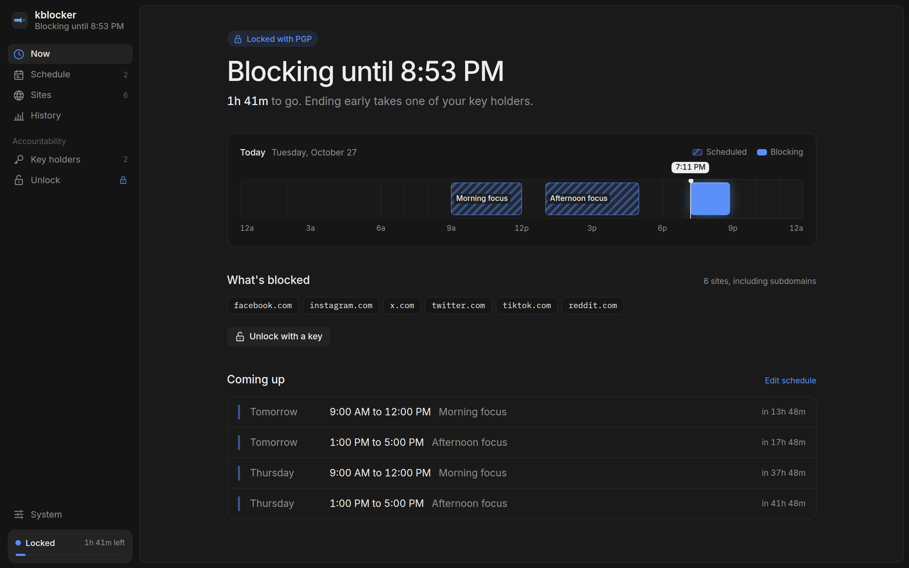
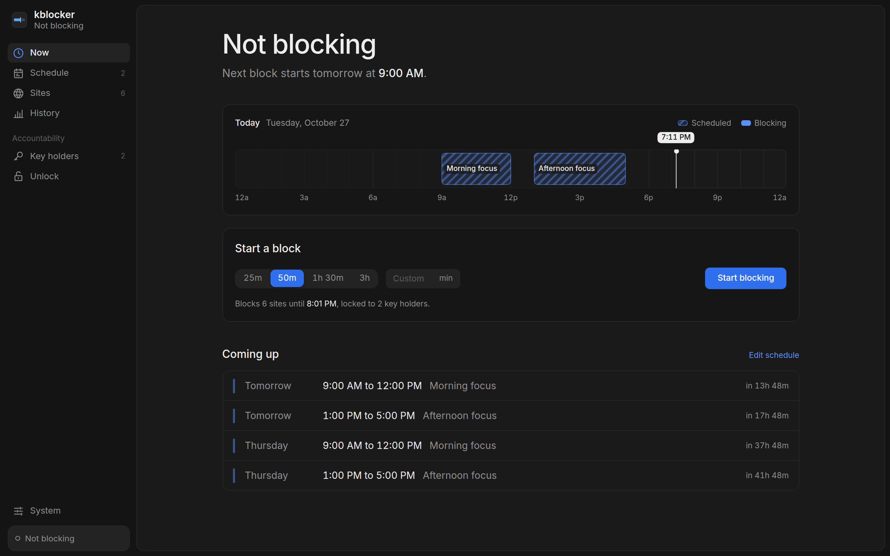
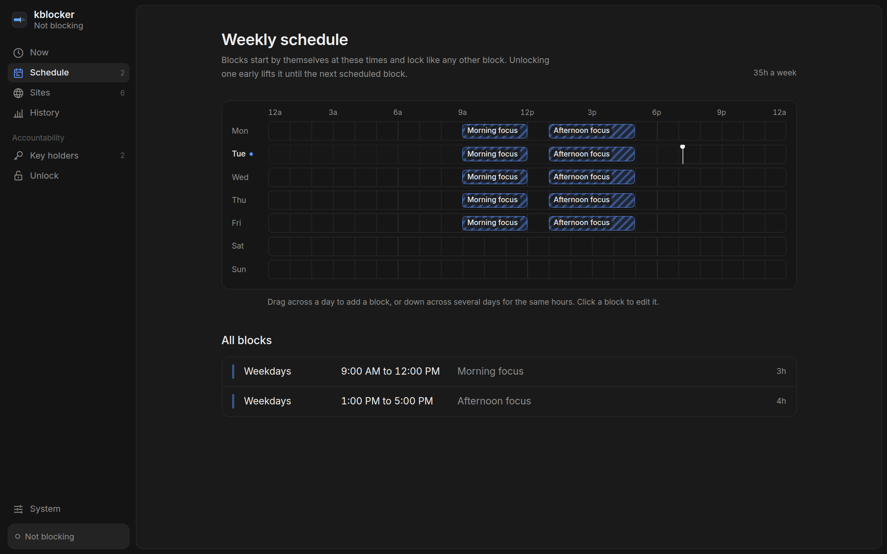
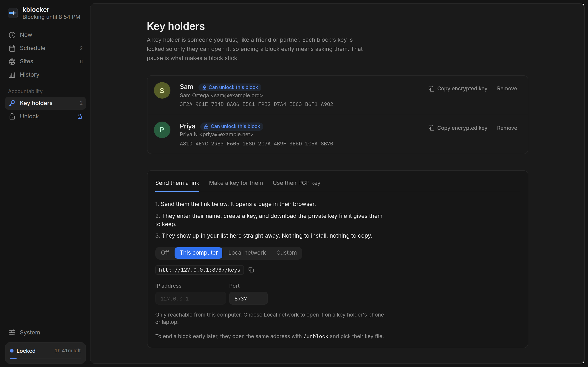
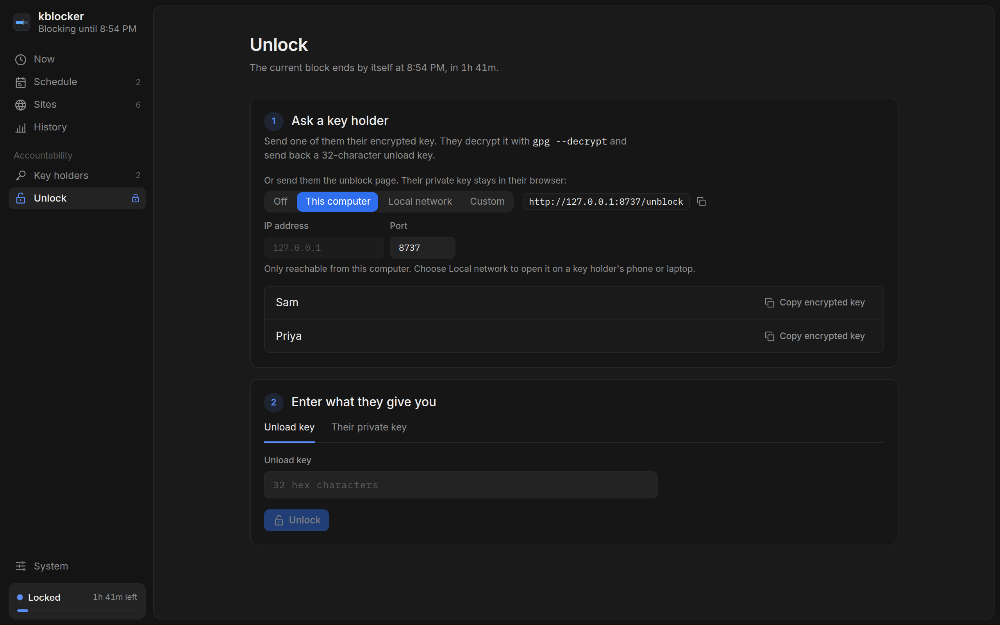
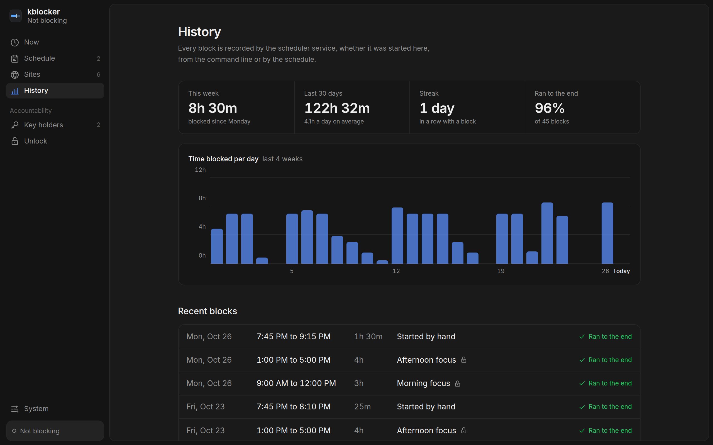
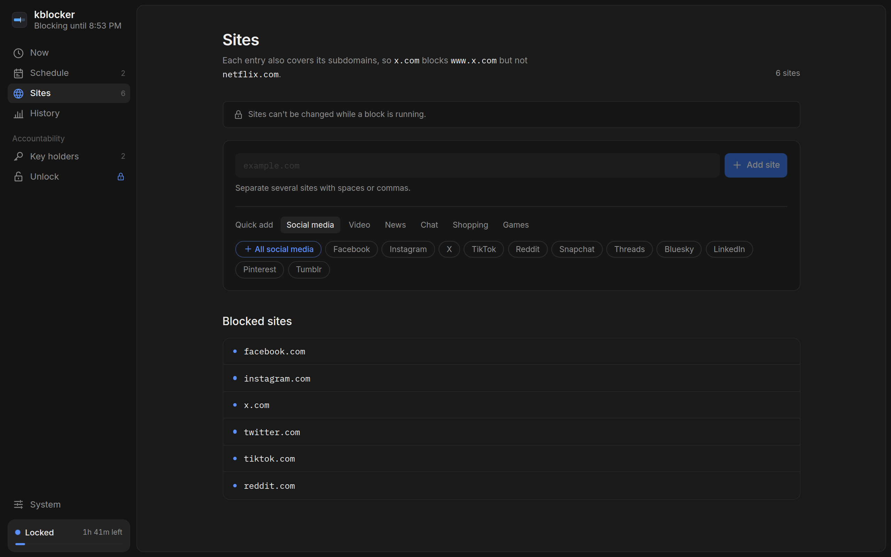

<div align="center">

# 🔒 kblocker

**A kernel-level site blocker you can't talk yourself out of.**

kblocker drops connections to distracting sites from inside the Linux kernel, then locks the off switch<br>
with a key only someone you trust can open. Ending a block early becomes a conversation, not an impulse.




</div>

## 🤔 Why kblocker?

Most blockers are a browser extension or a hosts file away from being turned off, and the person most likely to turn them off is you. kblocker is built to remove your own agency in that moment of weakness.

- 🧱 **Blocks in the kernel.** A netfilter module inspects the TLS SNI of outgoing connections and drops the ones you've blocked, in every browser and app. QUIC is dropped during a block so nothing sneaks past over UDP.
- 🔑 **The off switch needs a key.** Disabling or unloading the module takes a 128-bit key, checked against a SHA-256 hash held in the kernel.
- 🤝 **Someone else holds that key.** With PGP mode the key is encrypted to your key holders (a friend, a partner) and then **erased from kernel memory**. You've outsourced your willpower.
- 🛡️ **Hard to tamper with.** During a block the module, its auto-load config, `/etc/hosts` and the state file are made immutable by the kernel itself, and `chattr` is refused.
- ⏱️ **The clock can't be cheated.** Blocks run on the boot-time clock, so changing the system time does nothing, and a locked block survives a reboot.
- 🗓️ **Runs on a schedule.** Set weekly focus windows and a service starts a locked block whenever one opens, and keeps a history of every block.

## 📸 Screenshots

All screenshots show the real desktop app with its built-in demo data.

<table>
  <tr>
    <td width="50%">
      <b>Start a block</b>: pick a length and lock it to your key holders<br><br>
      
    </td>
    <td width="50%">
      <b>Weekly schedule</b>: drag across the week to add focus blocks<br><br>
      
    </td>
  </tr>
  <tr>
    <td width="50%">
      <b>Key holders</b>: the people who can end a block early<br><br>
      
    </td>
    <td width="50%">
      <b>Unlock</b>: ask a key holder, then enter what they send back<br><br>
      
    </td>
  </tr>
  <tr>
    <td width="50%">
      <b>History</b>: time blocked per day, streaks and every past block<br><br>
      
    </td>
    <td width="50%">
      <b>Sites</b>: quick-add whole categories; subdomains included<br><br>
      
    </td>
  </tr>
</table>

## 🚀 Quick start

You need Linux 6.3 or newer, kernel headers (`linux-headers-$(uname -r)`) and Go 1.21+.

**1. Build and install**

```sh
sudo make install
```

This loads the module (disabled), installs `kblockerctl`, enables the scheduler service and blocks a starter list of social media sites.

**2. Add a key holder**

```sh
sudo kblockerctl add-pgp sam.pub
```

No PGP key handy? Run `sudo kblockerctl web-pages lan` and send them `http://<your-machine>:8737/keys`: they create a key in their browser and it registers itself. The private key never leaves their browser.

**3. Block for an hour**

```sh
sudo kblockerctl enable 60
sudo kblockerctl status
```

**4. Ending early takes your key holder**

```sh
sudo kblockerctl unblock      # asks for the key they decrypted for you
```

Or send them `http://<your-machine>:8737/unblock` and they can decrypt it in their browser. Either way, the block also ends by itself when the time is up.

> 💡 **Just want to look around?** `cd gui && pnpm install && pnpm dev` runs the desktop app's UI in a browser with demo data, no kernel module needed.

## ✨ Features

### 🧱 Blocking

- Hooks `NF_INET_LOCAL_OUT` and `NF_INET_FORWARD`, so it covers this machine and anything it routes.
- Matches the TLS SNI, including the outer SNI of ECH hellos, against your list; domains are also null-routed via `/etc/hosts`.
- A rule covers the domain and every subdomain: `x.com` blocks `www.x.com`, not `netflix.com`.
- Block IPv4 and IPv6 addresses directly with `block-ip`.
- Exempt addresses or subnets (like a WireGuard network, `10.0.0.0/24`) with `allow-ip`; they can't be changed during a block.

### 🔐 Locking

- PGP mode encrypts the unload key to every registered key holder, then zeroes it in the kernel. Any one of them can unlock.
- Locked blocks are written to `/var/lib/kblocker/state` by the kernel and restored, still locked, after a reboot. Time spent powered off doesn't count.
- `--insecure` skips PGP and prints the key, for testing.

### 🗓️ Schedule and history

- Weekly windows in `/etc/kblocker/schedule.json`, started by `kblocker-scheduler.service` as PGP-locked blocks.
- Unlocking a scheduled block early lifts it until the next window. The schedule can't be edited mid-block.
- Every block is recorded in `/var/lib/kblocker/history.jsonl`; `kblockerctl history` sums it up.

### 🌐 Key holder pages

- The scheduler service hosts `/keys` (create and register a key) and `/unblock` (decrypt the unload key) on port 8737.
- Choose who can reach them: `off`, `local`, `lan` or `custom --bind <ip>` (a VPN address, say).
- OpenPGP.js is built into `kblockerctl`, not loaded from a CDN, and the pages only accept same-origin requests.

### 🖥️ Desktop app

- A Tauri app covering status, starting blocks, the schedule, history, sites, key holders and unlocking.
- The `.deb` installs it as `kblocker`, with a launcher in your app menu (or run `sudo kblocker`).
- Changes go through `pkexec kblockerctl` with the polkit policy `make install` puts in place, or straight to `kblockerctl` when the app runs as root. Scheduling and history keep working with the app closed.

## ⌨️ Commands at a glance

```sh
sudo kblockerctl enable <minutes>     # start a block
sudo kblockerctl status               # what's blocked and for how long
sudo kblockerctl unblock              # end it (needs the key)
sudo kblockerctl add <domain>         # add a site
sudo kblockerctl add-pgp <key.asc>    # add a key holder
sudo kblockerctl schedule set <file>  # set the weekly schedule
sudo kblockerctl history              # past blocks
sudo kblockerctl unload               # remove the module (needs the key)
```

The full list is in [docs/commands.md](docs/commands.md).

## 🏗️ How it fits together

```
 Desktop app (Tauri) ──pkexec──┐
                               ▼
 kblocker-scheduler.service ─► kblockerctl ──sysfs──► kblocker.ko (kernel)
   ├─ starts scheduled blocks                           ├─ netfilter: SNI / IP / QUIC drop
   ├─ records history                                   ├─ key: SHA-256 check, zeroed under PGP
   └─ key holder pages :8737                            ├─ file protection, re-checked every 1s
        ▲                                               └─ boot-time timer + persisted state
        └── key holder's browser (OpenPGP.js)
```

## 📚 Documentation

| | |
|---|---|
| ⌨️ [Command reference](docs/commands.md) | Every command, PGP mode, reboots, insecure mode, the schedule format and key holder pages |
| 🏗️ [Architecture](docs/architecture.md) | Kernel and userspace layout, sysfs interface, file protection, key lifecycle |
| 🧪 [Development and tests](docs/development.md) | Building, the desktop app, `.deb` packaging, integration tests, syzkaller fuzzing, property tests |

## ⚠️ Status

kblocker is a kernel module that guards its own files, so try it in a VM before trusting it on your daily machine. Unloading needs the key even when no block is running; a locked block always ends by itself when its time is up. The module is fuzzed with syzkaller under KASAN, KCSAN and lockdep, and its parsers have property tests under ASan and UBSan.

## 📄 License

[Apache License 2.0](LICENSE)
